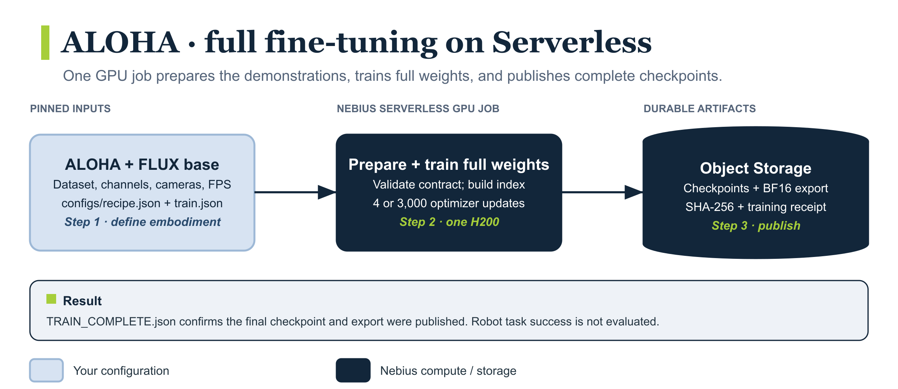

<p align="center">
  <a href="https://bfl.ai"><picture>
    <source media="(prefers-color-scheme: dark)" srcset="assets/black-forest-labs-white.svg">
    
  </picture></a>
  &nbsp;&nbsp;&nbsp;&nbsp;
  <a href="https://nebius.com"><picture>
    <source media="(prefers-color-scheme: dark)" srcset="assets/nebius-white.svg">
    
  </picture></a>
</p>

# Full fine-tune Black Forest Labs FLUX 3 Action for a new robot embodiment

This demo trains the weights of [Black Forest Labs FLUX 3 Action base](https://docs.bfl.ai/flux_3/flux3_action_finetuning) and a new 14-action ALOHA head on **one Nebius H200**. It uses [ALOHA Static Cups Open](https://huggingface.co/datasets/lerobot/aloha_static_cups_open), a small MIT-licensed dataset. The model has its own [license](https://huggingface.co/black-forest-labs/flux-3-action-base) and requires access on Hugging Face. For a task LoRA on Black Forest Labs' prepared SO-101 policy, use the [SO-101 demo](../bfl-flux-action-so101-pick-orange-task-lora/README.md).

The demo downloads pinned model and dataset revisions, trains four updates as a smoke test or 3,000 updates as a full run, and saves checkpoints and a BF16 export to Nebius Object Storage. Preparation and training run inside the Serverless GPU job. A Nebius smoke on 2026-10-23 completed preparation, four optimizer updates, checkpoint publication, and BF16 export; independent Object Storage readback verified the export hash. An earlier run completed 3,000 updates. The full export has not been reloaded independently, and robot task success has not been measured. This cookbook ends with the published weights and training receipt.

## Workflow

[](assets/workflow.png)

## Requirements and compute

- Local tools: authenticated Nebius CLI, Docker with Linux AMD64 build support, and AWS CLI configured for Object Storage. No local GPU is required.
- A Nebius project, subnet, Object Storage bucket, container registry, and quota for the resources below. Keep the resources in the same region.
- Hugging Face model access: accept the linked model's access terms where required, and supply the token through `NEBIUS_HF_TOKEN_SECRET`.

| Stage | Resources | Work |
| --- | --- | --- |
| Training | One H200, `1gpu-16vcpu-200gb`, 300 GiB scratch disk | Smoke: four optimizer updates; full run: 3,000. |

Wall-clock runtime, download size, and peak scratch usage have not been benchmarked for the current image. The 168-hour job timeout is a ceiling, not an estimated duration. Account for model/data downloads and export publication as well as training.

## Files

| Path | Purpose |
| --- | --- |
| `Dockerfile` | Build the pinned training environment. |
| `assets/` | Workflow diagram, official logos, and logo source URLs. |
| `configs/` | Pinned model, dataset, and training settings. |
| `scripts/job.sh` | Submit smoke and full-training jobs. |
| `src/` | Dataset preparation, full-weight training, and export publication. |
| `tests/` | Local job-helper and artifact-publication checks; no cloud submission. |

## 1. Configure and build

Run the following commands from this example directory:

```bash
export NEBIUS_PROFILE=YOUR_PROFILE
export NEBIUS_PROJECT_ID=YOUR_PROJECT_ID
export NEBIUS_SUBNET_ID=YOUR_SUBNET_ID
export NEBIUS_BUCKET=YOUR_BUCKET_NAME
export NEBIUS_BUCKET_ID=YOUR_STORAGEBUCKET_ID
export NEBIUS_REGISTRY_ID=YOUR_REGISTRY_ID
export NEBIUS_REGION=YOUR_REGION
export NEBIUS_S3_ENDPOINT="https://storage.$NEBIUS_REGION.nebius.cloud"
export AWS_PROFILE=YOUR_OBJECT_STORAGE_PROFILE
export NEBIUS_IMAGE="cr.$NEBIUS_REGION.nebius.cloud/${NEBIUS_REGISTRY_ID#registry-}/bfl-a:$(date -u +%m%d%H%M%S)"
docker build --platform linux/amd64 -t "$NEBIUS_IMAGE" .
docker push "$NEBIUS_IMAGE"
```

If Hugging Face requires a token, set `NEBIUS_HF_TOKEN_SECRET` to its **Nebius MysteryBox secret selector**. The job reads the token as `HF_TOKEN`; do not put the token in the image.

## 2. Try a short run

```bash
export RUN_NAME="flux-aloha-smoke-$(date -u +%Y%m%dT%H%M%SZ)"
bash scripts/job.sh smoke
```

After submission, the helper prints the run name, artifact prefix, completion receipt, and commands to find and monitor the job. Save the returned job ID. Check the job and its result:

```bash
nebius ai job get SMOKE_JOB_ID --profile "$NEBIUS_PROFILE"
nebius ai job logs SMOKE_JOB_ID --profile "$NEBIUS_PROFILE" --tail 80
aws s3 cp "s3://$NEBIUS_BUCKET/runs/$RUN_NAME/TRAIN_COMPLETE.json" - \
  --endpoint-url "$NEBIUS_S3_ENDPOINT"
```

Expect a `COMPLETED` job and `optimizer_updates: 4` in `TRAIN_COMPLETE.json`. The run prefix also holds the pinned recipe, dataset index, metrics, checkpoint, and export. Use `bash scripts/job.sh smoke dry-run` to inspect a submission before sending it.

## 3. Train the full example

```bash
export RUN_NAME="flux-aloha-full-$(date -u +%Y%m%dT%H%M%SZ)"
bash scripts/job.sh full
nebius ai job get FULL_JOB_ID --profile "$NEBIUS_PROFILE"
nebius ai job logs FULL_JOB_ID --profile "$NEBIUS_PROFILE" --tail 80
aws s3 cp "s3://$NEBIUS_BUCKET/runs/$RUN_NAME/TRAIN_COMPLETE.json" - \
  --endpoint-url "$NEBIUS_S3_ENDPOINT"
```

Expect `optimizer_updates: 3000` and an `export_model_sha256` in the training receipt. A full run publishes checkpoints every 500 updates. Use a fresh `RUN_NAME` for every run.

## Use your own robot

Edit [`configs/recipe.json`](configs/recipe.json) for the dataset revision, robot type, ordered state and action channels, cameras, FPS, and reserved episodes. Edit [`configs/train.json`](configs/train.json) for the action head, camera layout, action horizon, timing, and schedule. Check action units and whether commands are absolute or deltas, both grippers' signs and ranges, camera order, and episode alignment against real recordings. The preparation step rejects mismatched metadata and policy settings. You must also map exported actions back into your robot's command frame and measure task success separately; matching 14 numbers alone is not enough.

## Check locally

Run the local submission and publication checks without contacting Nebius:

```bash
python3 -m unittest discover -s tests -v
```

## Storage, checkpoints, and interruption

Dataset preparation and training use local `/workspace/work` storage so video reads and training writes do not depend on the Object Storage mount. The bucket is mounted at `/workspace/data` for durable artifacts. Scratch disks and job timeouts are configured in `scripts/job.sh`; the defaults provide working room but are not measured minimums.

The trainer saves a complete checkpoint every 500 updates in a full run and publishes it before continuing; the four-update smoke publishes its final checkpoint. Publication copies the trainer's completion marker last. After training, the runner exports BF16 weights, records their SHA-256, and writes `TRAIN_COMPLETE.json`.

The exported policy comes from the final checkpoint; intermediate checkpoints are not ranked by quality. The runner does not reload the export or measure policy quality; the receipt records `quality_evaluation: "not_run"`. Neither this example nor its job helper implements automatic resume. After interruption, inspect the bucket for completed checkpoints and use a fresh `RUN_NAME` for a new run.

## Troubleshooting

Replace `JOB_ID` in the commands below with the ID returned by submission or the printed name lookup.

| Symptom | Diagnose and recover |
| --- | --- |
| Image label exceeds 64 characters | Use a short repository name and tag as above. If validation reports a `metadata.labels` length error, keep the complete image reference at most 64 characters. Long tags and full digest references exceed the limit in the current CLI/API path. |
| Model access denied | Inspect `nebius ai job logs JOB_ID --profile "$NEBIUS_PROFILE" --tail 80`. Accept the model access terms and set `NEBIUS_HF_TOKEN_SECRET` to a MysteryBox selector before a new submission. |
| Pending job or capacity error such as `NotEnoughResources` | Inspect `nebius ai job get JOB_ID --profile "$NEBIUS_PROFILE"` for scheduling details. Check the selected GPU quota and capacity in your region before retrying; a pending job is not evidence that training started. |
| `No space left on device` | Inspect the job logs for the failing path. Increase `--disk-size` in `scripts/job.sh` if scratch storage is exhausted, then submit a fresh run. |
| Interrupted job or timeout | Inspect job state and logs, then list `runs/$RUN_NAME/` in the bucket. Completed checkpoints can remain; a new training run starts from scratch under a fresh name. Increasing a timeout does not enable resume. |
| Run prefix already exists | Choose a fresh `RUN_NAME`; do not delete previous results just to reuse the name. |
| No `TRAIN_COMPLETE.json` | Inspect job state and logs. Individual checkpoints do not prove the requested training run finished; require both a completed job and its training receipt. |
