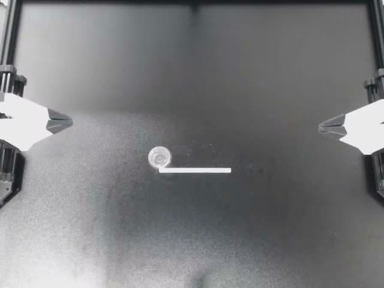
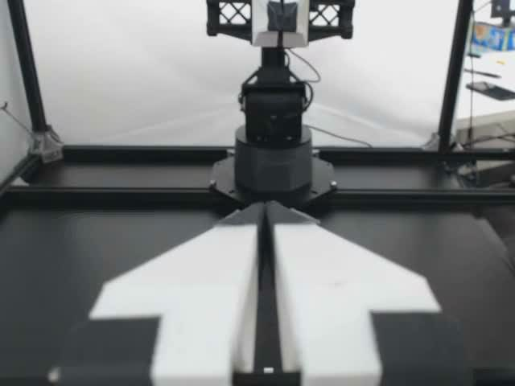
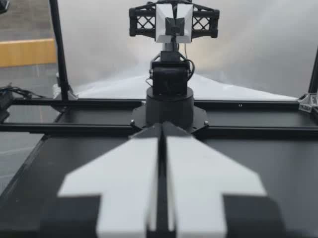

<p align="center">
  <a href="https://bfl.ai"><picture>
    <source media="(prefers-color-scheme: dark)" srcset="assets/black-forest-labs-white.svg">
    
  </picture></a>
  &nbsp;&nbsp;&nbsp;&nbsp;
  <a href="https://nebius.com"><picture>
    <source media="(prefers-color-scheme: dark)" srcset="assets/nebius-white.svg">
    
  </picture></a>
</p>

# Full fine-tune Black Forest Labs FLUX 3 Action for a new robot embodiment

This demo trains the weights of [Black Forest Labs FLUX 3 Action base](https://docs.bfl.ai/flux_3/flux3_action_finetuning) and a new 14-action ALOHA head on **one Nebius H200**. It uses [ALOHA Static Cups Open](https://huggingface.co/datasets/lerobot/aloha_static_cups_open), a small MIT-licensed dataset. The model has its own [license](https://huggingface.co/black-forest-labs/flux-3-action-base) and requires access on Hugging Face. For a task LoRA on Black Forest Labs' prepared SO-101 policy, use the [SO-101 demo](../bfl-flux-action-so101-pick-orange-task-lora/README.md).

The demo downloads pinned model and dataset revisions, trains four updates as a smoke test or 3,000 updates as a full run, and saves checkpoints and a BF16 export to Nebius Object Storage. Preparation and training run inside the Serverless GPU job. This cookbook ends with published weights and a training receipt; it does not measure robot task success.

## Reference smoke run

| Measured on 2026-10-26 | Result |
| --- | --- |
| GPU | One H200 |
| Training | Four optimizer updates |
| Container runtime | 11m 33s |
| Peak GPU memory | 68.6 GB |
| Final training loss | 1.5762 |
| Output | Complete checkpoint plus 13.9 GB BF16 export; export SHA-256 verified |

Container runtime includes preparation, model downloads, training, and publication; it excludes local image build/push, scheduling, and image pull. These are observations from one smoke using an image built from this Dockerfile, not a time-to-first-run guarantee. Cost and peak scratch usage were not measured; GPU runtime, storage, and transfers can contribute to the bill. An earlier run completed 3,000 updates; the current export has not been independently loaded into a policy.

## Workflow

[](assets/workflow.png)

## Dataset preview

| High camera | Left wrist | Right wrist |
| --- | --- | --- |
|  |  |  |

These are the first decoded frames of the three training camera streams, in recipe order, from [ALOHA Static Cups Open, pinned revision](https://huggingface.co/datasets/lerobot/aloha_static_cups_open/tree/d793c969cf716001dcca18a0842c3d7e9de9e41b), MIT license. They show demonstration inputs, not a trained-policy rollout. Videos: `videos/observation.images.cam_{high,left_wrist,right_wrist}/chunk-000/file-000.mp4`.

## Requirements and compute

- Local tools: authenticated Nebius CLI, Docker with Linux AMD64 build support, and AWS CLI configured for Object Storage. Python 3.11+ runs the local checks and artifact verification. No local GPU is required.
- Result verification needs about 14 GB of free local disk space, in addition to Docker build storage.
- A Nebius project, subnet, Object Storage bucket, container registry, and quota for the resources below. Keep the resources in the same region.
- Hugging Face model access: accept the linked model's access terms where required, and supply the token through `NEBIUS_HF_TOKEN_SECRET`.

| Stage | Resources | Work |
| --- | --- | --- |
| Training | One H200, `1gpu-16vcpu-200gb`, 300 GiB scratch disk | Smoke: four optimizer updates; full run: 3,000. |

Cold-start time, download size, and peak scratch usage have not been benchmarked. The 168-hour job timeout is a ceiling, not an estimated duration. Account for model/data downloads and export publication as well as training.

## Files

| Path | Purpose |
| --- | --- |
| `Dockerfile` | Build the pinned training environment. |
| `assets/` | Workflow diagram, official logos, and logo source URLs. |
| `configs/` | Pinned model, dataset, and training settings. |
| `scripts/job.sh` | Submit smoke and full-training jobs. |
| `scripts/verify.py` | Independently hash downloaded final weights and check completion markers. |
| `src/` | Dataset preparation, full-weight training, and export publication. |
| `tests/` | Local job-helper and artifact-publication checks; no cloud submission. |

## 1. Configure and build

Clone the repository and enter this example:

```bash
git clone https://github.com/nebius/serverless-ai-cookbook.git
cd serverless-ai-cookbook
```

If you are reading an unmerged PR, check out that PR here. Then enter the example:

```bash
cd robotics/bfl-flux-action-new-embodiment-full-finetune
```

Prepare the resources below once, then fill in the exports. Reuse a project-specific CLI profile and keep the bucket, registry, subnet, and GPU job in the same region.

| Requirement | Setup and value to copy |
| --- | --- |
| CLI profile and project | [Install](https://docs.nebius.com/cli/install) and [authenticate the CLI](https://docs.nebius.com/cli/configure); copy the profile name and `project-…` ID. |
| Subnet | [Find your subnet ID](https://docs.nebius.com/vpc/networking/resources), `vpcsubnet-…`, in the selected project/region. |
| Object Storage | [Create a bucket](https://docs.nebius.com/object-storage/quickstart) and [configure AWS CLI credentials](https://docs.nebius.com/object-storage/interfaces/aws-cli); copy both its S3 name and `storagebucket-…` resource ID. |
| Container Registry | [Create a registry and configure Docker authentication](https://docs.nebius.com/container-registry/quickstart); copy its `registry-…` ID. |
| Hugging Face token | Accept the model access terms. [Create a SecretStash/MysteryBox secret version](https://docs.nebius.com/mysterybox/secrets/create) with payload key `HF_TOKEN`; copy the secret and version IDs, not the token. |

```bash
export NEBIUS_PROFILE=YOUR_PROFILE
export NEBIUS_PROJECT_ID=YOUR_PROJECT_ID
export NEBIUS_SUBNET_ID=YOUR_SUBNET_ID
export NEBIUS_BUCKET=YOUR_BUCKET_NAME
export NEBIUS_BUCKET_ID=YOUR_STORAGEBUCKET_ID
export NEBIUS_REGISTRY_ID=YOUR_REGISTRY_ID
export NEBIUS_REGION=YOUR_REGION
export NEBIUS_S3_ENDPOINT="https://storage.$NEBIUS_REGION.nebius.cloud"
export AWS_PROFILE=YOUR_OBJECT_STORAGE_PROFILE
export NEBIUS_HF_TOKEN_SECRET="mbsec-YOUR_SECRET_ID@mbsecver-YOUR_VERSION_ID"
export NEBIUS_IMAGE="cr.$NEBIUS_REGION.nebius.cloud/${NEBIUS_REGISTRY_ID#registry-}/bfl-a:$(date -u +%m%d%H%M%S)"
# Read-only checks before building or submitting:
nebius iam project get "$NEBIUS_PROJECT_ID" --profile "$NEBIUS_PROFILE"
aws s3 ls "s3://$NEBIUS_BUCKET/" --endpoint-url "$NEBIUS_S3_ENDPOINT"
python3 -m unittest discover -s tests -v

docker build --platform linux/amd64 -t "$NEBIUS_IMAGE" .
docker push "$NEBIUS_IMAGE"
```

`NEBIUS_HF_TOKEN_SECRET` is a **secret/version selector**, not a Hugging Face token. The job receives the selected payload as `HF_TOKEN`; never put the token in the image or repository. SecretStash is the current product name; CLI/API commands still use `mysterybox`.

## 2. Try a short run

```bash
export RUN_NAME="flux-aloha-smoke-$(date -u +%Y%m%dT%H%M%SZ)"
bash scripts/job.sh smoke dry-run
bash scripts/job.sh smoke
```

After submission, the helper prints the run name, artifact prefix, completion receipt, and commands to find and monitor the job. Save the returned job ID. Check the job and its result:

```bash
nebius ai job get SMOKE_JOB_ID --profile "$NEBIUS_PROFILE"
nebius ai job logs SMOKE_JOB_ID --profile "$NEBIUS_PROFILE" --tail 80
aws s3 cp "s3://$NEBIUS_BUCKET/runs/$RUN_NAME/TRAIN_COMPLETE.json" - \
  --endpoint-url "$NEBIUS_S3_ENDPOINT"
```

Expect a `COMPLETED` job and `optimizer_updates: 4` in `TRAIN_COMPLETE.json`. The run prefix also holds the pinned recipe, dataset index, metrics, checkpoint, and export. Use `bash scripts/job.sh smoke dry-run` to inspect a submission before sending it.

## Verify your result

First require the cloud job to report `COMPLETED`; the artifact checker does not query job state. The block stops on the first error and refuses an existing local results directory. To repeat a download, move the previous local results directory aside first, keeping the cloud `RUN_NAME` unchanged. Use the same steps for smoke and full runs:

```bash
(
set -euo pipefail
nebius ai job get JOB_ID --profile "$NEBIUS_PROFILE"
export RESULTS_DIR="results/$RUN_NAME"
mkdir -p results
mkdir "$RESULTS_DIR"
# The export is about 13.9 GB; the optimizer checkpoint is not downloaded.
aws s3 cp "s3://$NEBIUS_BUCKET/runs/$RUN_NAME/TRAIN_COMPLETE.json" "$RESULTS_DIR/" \
  --endpoint-url "$NEBIUS_S3_ENDPOINT"
CHECKPOINT=$(python3 -c 'import json,sys; print(json.load(open(sys.argv[1]))["checkpoint"])' "$RESULTS_DIR/TRAIN_COMPLETE.json")
mkdir -p "$RESULTS_DIR/$CHECKPOINT"
aws s3 cp "s3://$NEBIUS_BUCKET/runs/$RUN_NAME/$CHECKPOINT/COMPLETE" "$RESULTS_DIR/$CHECKPOINT/" \
  --endpoint-url "$NEBIUS_S3_ENDPOINT"
aws s3 cp "s3://$NEBIUS_BUCKET/runs/$RUN_NAME/export/" "$RESULTS_DIR/export/" \
  --recursive --endpoint-url "$NEBIUS_S3_ENDPOINT"
python3 scripts/verify.py "$RESULTS_DIR"
)
```

A successful check prints the independently computed SHA-256 values and a final `PASS:` line. A missing marker or changed weight file exits nonzero. Hash verification establishes artifact integrity; it does not reload the policy or measure robot task success.

A smoke receipt contains these fields (other metadata omitted):

```json
{
  "status": "trained",
  "optimizer_updates": 4,
  "checkpoint": "checkpoints/step-4",
  "export": "export",
  "export_model_sha256": "<64-character SHA-256>",
  "quality_evaluation": "not_run"
}
```

Expected smoke output layout:

```text
runs/$RUN_NAME/
├── TRAIN_COMPLETE.json
├── PREPARED.json
├── recipe.json, train.json, manifest.json, statistics.json, metrics.jsonl
├── checkpoints/step-4/
│   ├── COMPLETE
│   └── model/, optimizer/, rng/, config.json, state.json
└── export/
    ├── config.json, manifest.json
    └── model.safetensors
```

## 3. Train the full example

```bash
export RUN_NAME="flux-aloha-full-$(date -u +%Y%m%dT%H%M%SZ)"
bash scripts/job.sh full
nebius ai job get FULL_JOB_ID --profile "$NEBIUS_PROFILE"
nebius ai job logs FULL_JOB_ID --profile "$NEBIUS_PROFILE" --tail 80
aws s3 cp "s3://$NEBIUS_BUCKET/runs/$RUN_NAME/TRAIN_COMPLETE.json" - \
  --endpoint-url "$NEBIUS_S3_ENDPOINT"
```

Expect `optimizer_updates: 3000` and an `export_model_sha256` in the training receipt. A full run publishes checkpoints every 500 updates. Use a fresh `RUN_NAME` for every run.

## Use your own robot

Edit [`configs/recipe.json`](configs/recipe.json) for the dataset revision, robot type, ordered state and action channels, cameras, FPS, and reserved episodes. Edit [`configs/train.json`](configs/train.json) for the action head, camera layout, action horizon, timing, and schedule. Check action units and whether commands are absolute or deltas, both grippers' signs and ranges, camera order, and episode alignment against real recordings. The preparation step rejects mismatched metadata and policy settings. You must also map exported actions back into your robot's command frame and measure task success separately; matching 14 numbers alone is not enough.

## Check locally

Run the local submission and publication checks without contacting Nebius:

```bash
python3 -m unittest discover -s tests -v
```

## Storage, checkpoints, and interruption

Dataset preparation and training use local `/workspace/work` storage so video reads and training writes do not depend on the Object Storage mount. The bucket is mounted at `/workspace/data` for durable artifacts. Scratch disks and job timeouts are configured in `scripts/job.sh`; the defaults provide working room but are not measured minimums.

The trainer saves a complete checkpoint every 500 updates in a full run and publishes it before continuing; the four-update smoke publishes its final checkpoint. Publication copies the trainer's completion marker last. After training, the runner exports BF16 weights, records their SHA-256, and writes `TRAIN_COMPLETE.json`.

The exported policy comes from the final checkpoint; intermediate checkpoints are not ranked by quality. The runner does not reload the export or measure policy quality; the receipt records `quality_evaluation: "not_run"`. Neither this example nor its job helper implements automatic resume. After interruption, inspect the bucket for completed checkpoints and use a fresh `RUN_NAME` for a new run.

## Clean up

To stop an unfinished job, cancel that specific job:

```bash
nebius ai job cancel JOB_ID --profile "$NEBIUS_PROFILE"
```

After completion, scratch storage is ephemeral. Published run artifacts and registry images remain and can incur storage charges. Keep the final weights and receipt until you have saved what you need. Preview deletion of only this run's prefix:

```bash
aws s3 rm "s3://$NEBIUS_BUCKET/runs/${RUN_NAME:?set RUN_NAME}/" \
  --recursive --dryrun --endpoint-url "$NEBIUS_S3_ENDPOINT"
```

Inspect that list, then remove `--dryrun` only if you intend to delete those artifacts. Remove the local image with `docker image rm "$NEBIUS_IMAGE"`; delete the corresponding remote image/tag separately in Container Registry when it is no longer needed. Preserve shared buckets, registries, and secrets.

## Run with a coding agent

Paste this prompt into your coding agent from this example directory:

```text
Read README.md, Dockerfile, configs/, scripts/job.sh, and scripts/verify.py.
Use the existing NEBIUS_* and AWS_PROFILE environment settings. If required
resource IDs or the HF secret selector are missing, ask for them. Never search
other files for credentials, print token values, or put credentials in images.
Run local tests. Build and push the documented Linux AMD64 image, then run
bash scripts/job.sh smoke dry-run. Resolve validation errors before submitting one
smoke job. Record its ID and RUN_NAME; monitor that job to a terminal state
without submitting duplicates. Require COMPLETED, follow Verify your result,
and report steps, runtime, artifact locations, and independently checked hashes.
Do not launch full training or delete cloud resources. Do not claim policy
quality from finite loss or successful publication.
```

## Troubleshooting

Replace `JOB_ID` in the commands below with the ID returned by submission or the printed name lookup.

| Symptom | Diagnose and recover |
| --- | --- |
| Image label exceeds 64 characters | Use a short repository name and tag as above. If validation reports a `metadata.labels` length error, keep the complete image reference at most 64 characters. Long tags and full digest references exceed the limit in the current CLI/API path. |
| Model access denied | Inspect `nebius ai job logs JOB_ID --profile "$NEBIUS_PROFILE" --tail 80`. Accept the model access terms and set `NEBIUS_HF_TOKEN_SECRET` to a MysteryBox selector before a new submission. |
| Pending job or capacity error such as `NotEnoughResources` | Inspect `nebius ai job get JOB_ID --profile "$NEBIUS_PROFILE"` for scheduling details. Check the selected GPU quota and capacity in your region before retrying; a pending job is not evidence that training started. |
| `No space left on device` | Inspect the job logs for the failing path. Increase `--disk-size` in `scripts/job.sh` if scratch storage is exhausted, then submit a fresh run. |
| Interrupted job or timeout | Inspect job state and logs, then list `runs/$RUN_NAME/` in the bucket. Completed checkpoints can remain; a new training run starts from scratch under a fresh name. Increasing a timeout does not enable resume. |
| Run prefix already exists | Choose a fresh `RUN_NAME`; do not delete previous results just to reuse the name. |
| No `TRAIN_COMPLETE.json` | Inspect job state and logs. Individual checkpoints do not prove the requested training run finished; require both a completed job and its training receipt. |
