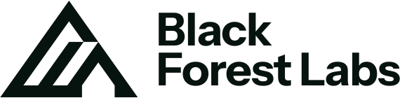
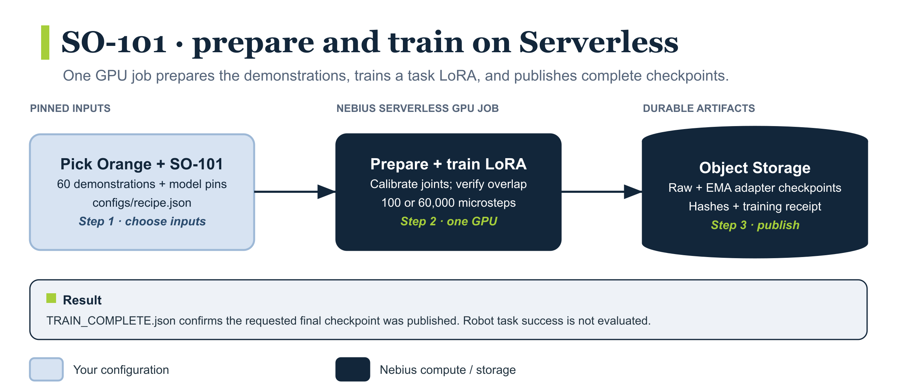
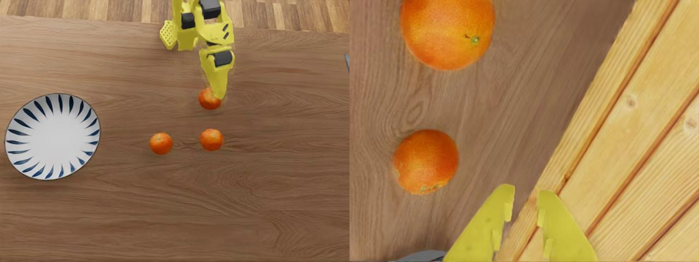

<p align="center">
  <a href="https://bfl.ai"><picture>
    <source media="(prefers-color-scheme: dark)" srcset="assets/black-forest-labs-white.svg">
    
  </picture></a>
  &nbsp;&nbsp;&nbsp;&nbsp;
  <a href="https://nebius.com"><picture>
    <source media="(prefers-color-scheme: dark)" srcset="assets/nebius-white.svg">
    
  </picture></a>
</p>

# Train a Black Forest Labs FLUX 3 Action SO-101 Pick Orange task LoRA

This demo trains a **task LoRA** on [Black Forest Labs' prepared SO-101 policy](https://docs.bfl.ai/flux_3/flux3_action_so101). It uses one Nebius GPU Job and 60 demonstrations from [LeIsaac Pick Orange](https://huggingface.co/datasets/LightwheelAI/leisaac-pick-orange) (Apache 2.0). The model uses the [FLUX Kommunity License](https://huggingface.co/black-forest-labs/flux-3-action-so101). To train full weights for a different robot, use the [new embodiment demo](../bfl-flux-action-new-embodiment-full-finetune/README.md).

The demo downloads pinned data and model revisions, converts LeIsaac's joint values into the model's SO-101 frame, trains 100 microsteps for a smoke test or 60,000 for the example full run, and publishes adapters to Nebius Object Storage. Preparation and training run inside the Serverless job; no local GPU or simulator is required. This cookbook ends with published adapters and a training receipt; it does not measure robot task success.

## Reference smoke run

| Measured on 2026-10-26 | Result |
| --- | --- |
| GPU | One H200 |
| Training | 100 microsteps / 25 optimizer updates |
| Container runtime | 8m 07s |
| Peak GPU memory | 29.83 GB |
| Final reported training loss | 0.276 |
| Output | Raw and EMA adapters, about 472 MB each; both SHA-256 hashes verified |

Container runtime includes preparation, model downloads, training, and publication; it excludes local image build/push, scheduling, and image pull. These are observations from one smoke using an image built from this Dockerfile, not a time-to-first-run guarantee. Cost and peak scratch usage were not measured; GPU runtime, storage, and transfers can contribute to the bill. The calibrated 60,000-microstep run remains unverified.

## Workflow

[](assets/workflow.png)

## Dataset preview



Left: front camera, mapped to the policy's scene camera. Right: wrist camera. The task is “Grab orange and place into plate.” These are demonstration inputs, not a trained-policy rollout. Source: [LightwheelAI/LeIsaac Pick Orange, pinned revision](https://huggingface.co/datasets/LightwheelAI/leisaac-pick-orange/tree/fa6e0625d814352b8e6ee1c6d2482194e4da8ed3), Apache 2.0. Each run also publishes its first-frame `camera-preview.jpg`.

## Requirements and compute

- Local tools: authenticated Nebius CLI, Docker with Linux AMD64 build support, and AWS CLI configured for Object Storage. Python 3.11+ runs the local checks and artifact verification.
- Result verification needs about 1 GB of free local disk space, in addition to Docker build storage.
- A Nebius project, subnet, Object Storage bucket, container registry, and quota for the resources below. Keep the resources in the same region.
- Hugging Face model access: accept the linked model's access terms where required, and supply the token through `NEBIUS_HF_TOKEN_SECRET`.

| Stage | Resources | Work |
| --- | --- | --- |
| Training | Default: one H200, `1gpu-16vcpu-200gb`, 200 GiB scratch disk | Smoke: 100 microsteps; documented full run: 60,000. |

Cold-start time, download size, and peak scratch usage have not been benchmarked. The 72-hour job timeout is a ceiling, not an estimated duration. The training receipt records `train_seconds` for training and publication; it excludes data preparation and model downloads.

## Files

| Path | Purpose |
| --- | --- |
| `Dockerfile` | Build the pinned training environment. |
| `assets/` | Workflow diagram, official logos, and logo source URLs. |
| `configs/` | Pinned model, dataset, and training settings. |
| `scripts/job.sh` | Submit smoke and full-training jobs. |
| `scripts/verify.py` | Independently hash downloaded final weights and check completion markers. |
| `src/` | Dataset preparation, joint calibration, training, and checkpoint publication. |
| `tests/` | Local checks for job submission, calibration, dataset contracts, and publication. |

## 1. Configure and build

Clone the repository and enter this example:

```bash
git clone https://github.com/nebius/serverless-ai-cookbook.git
cd serverless-ai-cookbook
```

If you are reading an unmerged PR, check out that PR here. Then enter the example:

```bash
cd robotics/bfl-flux-action-so101-pick-orange-task-lora
```

Prepare the resources below once, then fill in the exports. Reuse a project-specific CLI profile and keep the bucket, registry, subnet, and GPU job in the same region.

| Requirement | Setup and value to copy |
| --- | --- |
| CLI profile and project | [Install](https://docs.nebius.com/cli/install) and [authenticate the CLI](https://docs.nebius.com/cli/configure); copy the profile name and `project-…` ID. |
| Subnet | [Find your subnet ID](https://docs.nebius.com/vpc/networking/resources), `vpcsubnet-…`, in the selected project/region. |
| Object Storage | [Create a bucket](https://docs.nebius.com/object-storage/quickstart) and [configure AWS CLI credentials](https://docs.nebius.com/object-storage/interfaces/aws-cli); copy both its S3 name and `storagebucket-…` resource ID. |
| Container Registry | [Create a registry and configure Docker authentication](https://docs.nebius.com/container-registry/quickstart); copy its `registry-…` ID. |
| Hugging Face token | Accept the model access terms. [Create a SecretStash/MysteryBox secret version](https://docs.nebius.com/mysterybox/secrets/create) with payload key `HF_TOKEN`; copy the secret and version IDs, not the token. |

```bash
export NEBIUS_PROFILE=YOUR_PROFILE
export NEBIUS_PROJECT_ID=YOUR_PROJECT_ID
export NEBIUS_SUBNET_ID=YOUR_SUBNET_ID
export NEBIUS_BUCKET=YOUR_BUCKET_NAME
export NEBIUS_BUCKET_ID=YOUR_STORAGEBUCKET_ID
export NEBIUS_REGISTRY_ID=YOUR_REGISTRY_ID
export NEBIUS_REGION=YOUR_REGION
export NEBIUS_GPU_PLATFORM=gpu-h200-sxm
export NEBIUS_S3_ENDPOINT="https://storage.$NEBIUS_REGION.nebius.cloud"
export AWS_PROFILE=YOUR_OBJECT_STORAGE_PROFILE
export NEBIUS_HF_TOKEN_SECRET="mbsec-YOUR_SECRET_ID@mbsecver-YOUR_VERSION_ID"
export NEBIUS_IMAGE="cr.$NEBIUS_REGION.nebius.cloud/${NEBIUS_REGISTRY_ID#registry-}/bfl-s:$(date -u +%m%d%H%M%S)"
# Read-only checks before building or submitting:
nebius iam project get "$NEBIUS_PROJECT_ID" --profile "$NEBIUS_PROFILE"
aws s3 ls "s3://$NEBIUS_BUCKET/" --endpoint-url "$NEBIUS_S3_ENDPOINT"
python3 -m unittest discover -s tests -v

docker build --platform linux/amd64 -t "$NEBIUS_IMAGE" .
docker push "$NEBIUS_IMAGE"
```

`NEBIUS_HF_TOKEN_SECRET` is a **secret/version selector**, not a Hugging Face token. The job receives the selected payload as `HF_TOKEN`; never put the token in the image or repository. SecretStash is the current product name; CLI/API commands still use `mysterybox`. W&B tracking is optional: set `WANDB_API_KEY` to a MysteryBox selector and `WANDB_PROJECT` to a project name before submitting.

## 2. Try a short run

```bash
export RUN_NAME="flux-orange-smoke-$(date -u +%Y%m%dT%H%M%SZ)"
bash scripts/job.sh smoke dry-run
bash scripts/job.sh smoke
```

After submission, the helper prints the run name, artifact prefix, completion receipt, and commands to find and monitor the job. Save the returned job ID. Check the job and its durable result:

```bash
nebius ai job get SMOKE_JOB_ID --profile "$NEBIUS_PROFILE"
nebius ai job logs SMOKE_JOB_ID --profile "$NEBIUS_PROFILE" --tail 50
aws s3 cp "s3://$NEBIUS_BUCKET/runs/$RUN_NAME/TRAIN_COMPLETE.json" - \
  --endpoint-url "$NEBIUS_S3_ENDPOINT"
```

Expect `COMPLETED`, `microsteps: 100`, and an adapter hash in `TRAIN_COMPLETE.json`. Inspect `calibration-report.json` and `camera-preview.jpg` in the same run prefix before a long run. The report flags how far the demonstrations extend beyond the checkpoint's usual joint range. Use `bash scripts/job.sh smoke dry-run` to inspect a submission before sending it.

## Verify your result

First require the cloud job to report `COMPLETED`; the artifact checker does not query job state. The block stops on the first error and refuses an existing local results directory. To repeat a download, move the previous local results directory aside first, keeping the cloud `RUN_NAME` unchanged. The adapters total about 944 MB; optimizer state is excluded. Use the same steps for smoke and full runs:

```bash
(
set -euo pipefail
nebius ai job get JOB_ID --profile "$NEBIUS_PROFILE"
export RESULTS_DIR="results/$RUN_NAME"
mkdir -p results
mkdir "$RESULTS_DIR"
aws s3 cp "s3://$NEBIUS_BUCKET/runs/$RUN_NAME/TRAIN_COMPLETE.json" "$RESULTS_DIR/" \
  --endpoint-url "$NEBIUS_S3_ENDPOINT"
CHECKPOINT=$(python3 -c 'import json,sys; print(json.load(open(sys.argv[1]))["selected_checkpoint"].rsplit("/",1)[0])' "$RESULTS_DIR/TRAIN_COMPLETE.json")
aws s3 cp "s3://$NEBIUS_BUCKET/runs/$RUN_NAME/$CHECKPOINT/" "$RESULTS_DIR/$CHECKPOINT/" \
  --recursive --exclude "training_state/*" --endpoint-url "$NEBIUS_S3_ENDPOINT"
python3 scripts/verify.py "$RESULTS_DIR"
)
```

A successful check prints the independently computed SHA-256 values and a final `PASS:` line. A missing marker or changed weight file exits nonzero. Hash verification establishes artifact integrity; it does not reload the policy or measure robot task success.

A smoke receipt contains these fields (other metadata omitted):

```json
{
  "status": "trained",
  "microsteps": 100,
  "optimizer_updates": 25,
  "selected_checkpoint": "checkpoints/000100/pretrained_model",
  "quality_evaluation": "not_run"
}
```

Expected smoke output layout:

```text
runs/$RUN_NAME/
├── TRAIN_COMPLETE.json
├── calibration-report.json
├── camera-preview.jpg
└── checkpoints/000100/
    ├── COMPLETE.json
    ├── pretrained_model/adapter_model.safetensors
    └── pretrained_model_ema/adapter_model.safetensors
```

## 3. Train the full adapter

```bash
export FULL_STEPS=60000
export RUN_NAME="flux-orange-full-$(date -u +%Y%m%dT%H%M%SZ)"
bash scripts/job.sh full
nebius ai job get FULL_JOB_ID --profile "$NEBIUS_PROFILE"
nebius ai job logs FULL_JOB_ID --profile "$NEBIUS_PROFILE" --tail 50
aws s3 cp "s3://$NEBIUS_BUCKET/runs/$RUN_NAME/TRAIN_COMPLETE.json" - \
  --endpoint-url "$NEBIUS_S3_ENDPOINT"
```

Expect a `COMPLETED` job and a `TRAIN_COMPLETE.json` with `microsteps: 60000`. The receipt names the final checkpoint; its `COMPLETE.json` records hashes for the raw and EMA adapters. Intermediate checkpoints are published every 5,000 microsteps. Use a fresh `RUN_NAME` for every run. If you choose `NEBIUS_PREEMPTIBLE=1`, completed checkpoints remain in Object Storage after interruption, but this demo does not automatically resume.

## Adapt and check locally

Edit [`configs/recipe.json`](configs/recipe.json) to change the pinned inputs. The calibration in [`src/calibration.py`](src/calibration.py) is specific to this dataset and SO-101 policy; verify joint units, signs, ranges, and camera order before substituting recordings. Use the [full fine-tuning example](../bfl-flux-action-new-embodiment-full-finetune/README.md) for a different embodiment.

Run the lightweight checks from this directory:

```bash
python3 -m unittest discover -s tests -v
```

The parquet/safetensors calibration check skips when its optional dependencies are absent locally; those dependencies are included in the training image.

## Storage, checkpoints, and interruption

Dataset preparation and training use local `/workspace/work` storage so video reads and training writes do not depend on the Object Storage mount. The bucket is mounted at `/workspace/data` for durable artifacts. Scratch disks and job timeouts are configured in `scripts/job.sh`; the defaults provide working room but are not measured minimums.

A background watcher checks for complete checkpoints every 30 seconds and copies them to the bucket. If publication fails, the runner stops the training process group and fails the job, preserving any checkpoints already published. For the documented 60,000-microstep run, checkpoints are saved every 5,000 microsteps. Publication records adapter hashes in `COMPLETE.json`; `TRAIN_COMPLETE.json` is written only after the requested final checkpoint is published. A completed checkpoint may survive an interrupted job even when the training receipt is absent.

`selected_checkpoint` in the receipt identifies **the final checkpoint**. The runner does not rank checkpoints or run policy evaluation; `quality_evaluation: "not_run"` makes that limit explicit in the receipt.

Preemptible execution is opt-in with `NEBIUS_PREEMPTIBLE=1` and disables automatic restart. There is no resume path: after interruption, inspect published checkpoints, then use a fresh `RUN_NAME` for a new training run. Reusing a run name is rejected to prevent overwrites.

## Clean up

To stop an unfinished job, cancel that specific job:

```bash
nebius ai job cancel JOB_ID --profile "$NEBIUS_PROFILE"
```

After completion, scratch storage is ephemeral. Published run artifacts and registry images remain and can incur storage charges. Keep the final weights and receipt until you have saved what you need. Preview deletion of only this run's prefix:

```bash
aws s3 rm "s3://$NEBIUS_BUCKET/runs/${RUN_NAME:?set RUN_NAME}/" \
  --recursive --dryrun --endpoint-url "$NEBIUS_S3_ENDPOINT"
```

Inspect that list, then remove `--dryrun` only if you intend to delete those artifacts. Remove the local image with `docker image rm "$NEBIUS_IMAGE"`; delete the corresponding remote image/tag separately in Container Registry when it is no longer needed. Preserve shared buckets, registries, and secrets.

## Run with a coding agent

Paste this prompt into your coding agent from this example directory:

```text
Read README.md, Dockerfile, configs/, scripts/job.sh, and scripts/verify.py.
Use the existing NEBIUS_* and AWS_PROFILE environment settings. If required
resource IDs or the HF secret selector are missing, ask for them. Never search
other files for credentials, print token values, or put credentials in images.
Run local tests. Build and push the documented Linux AMD64 image, then run
bash scripts/job.sh smoke dry-run. Resolve validation errors before submitting one
smoke job. Record its ID and RUN_NAME; monitor that job to a terminal state
without submitting duplicates. Require COMPLETED, follow Verify your result,
and report steps, runtime, artifact locations, and independently checked hashes.
Do not launch full training or delete cloud resources. Do not claim policy
quality from finite loss or successful publication.
```

## Troubleshooting

Replace `JOB_ID` in the commands below with the ID returned by submission or the printed name lookup.

| Symptom | Diagnose and recover |
| --- | --- |
| Image label exceeds 64 characters | Use a short repository name and tag as above. If validation reports a `metadata.labels` length error, keep the complete image reference at most 64 characters. Long tags and full digest references exceed the limit in the current CLI/API path. |
| Model access denied | Inspect `nebius ai job logs JOB_ID --profile "$NEBIUS_PROFILE" --tail 80`. Accept the model access terms and set `NEBIUS_HF_TOKEN_SECRET` to a MysteryBox selector before a new submission. |
| Pending job or capacity error such as `NotEnoughResources` | Inspect `nebius ai job get JOB_ID --profile "$NEBIUS_PROFILE"` for scheduling details. Check the selected GPU quota and capacity in your region before retrying; a pending job is not evidence that training started. |
| `No space left on device` | Inspect the job logs for the failing path. Increase `--disk-size` in `scripts/job.sh` if scratch storage is exhausted, then submit a fresh run. |
| Interrupted job or timeout | Inspect job state and logs, then list `runs/$RUN_NAME/` in the bucket. Completed checkpoints can remain; a new training run starts from scratch under a fresh name. Increasing a timeout does not enable resume. |
| Run prefix already exists | Choose a fresh `RUN_NAME`; do not delete previous results just to reuse the name. |
| No `TRAIN_COMPLETE.json` | Inspect job state and logs. Individual checkpoints do not prove the requested training run finished; require both a completed job and its training receipt. |
| Calibration check fails | Inspect `calibration-report.json` if written, and the job logs. Verify joint units, signs, ranges, and camera order against `src/calibration.py` and the pinned dataset before retrying. Keep the calibration checks enabled. |
